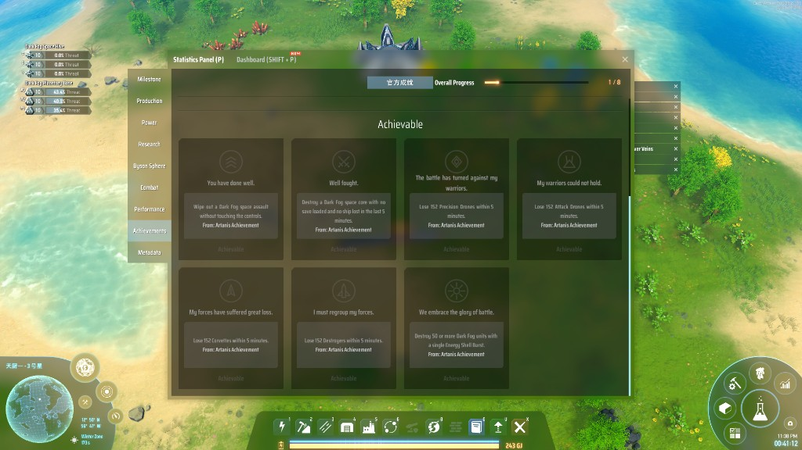
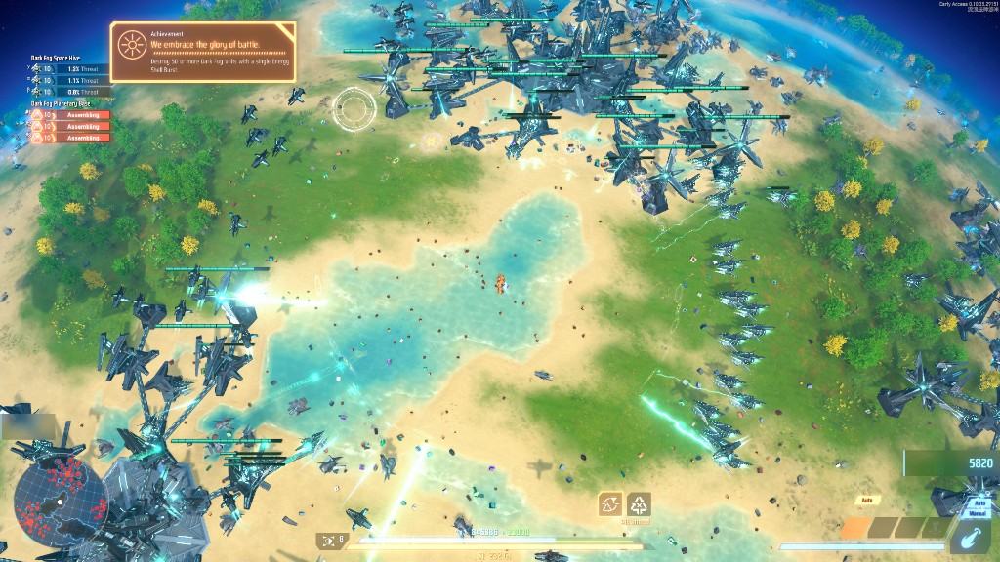

# Custom Achievements

https://github.com/cat-yummi-dspmod/DSP-CustomAchievements





<details>
<summary>English</summary>

A prerequisite mod that lets other mods add their own achievements to Dyson Sphere Program.

- **Separate file**: records are saved to `Documents/Dyson Sphere Program/CustomAchievements/<platform>_<userId>.dat`. The vanilla encrypted achievement file and Steam achievements are never touched.
- **GitHub ID**: every mod registers with its GitHub repository URL. An achievement's full ID is `github.com/owner/repo#key`.
- **Uninstalled mods**: names, descriptions and progress are stored with the record. If a mod is removed, its achievements still show (marked "not installed") and simply stop progressing.
- **Languages**: English is required, other languages are optional. The text shown follows the CatAPI rule: exact game language, then same primary language, then English.
- **In the vanilla panel**: Statistics → Achievements gets a "Mod Achievements" button at the top-left. It switches the panel to mod achievements, shown as vanilla-style cards (unlocked / in progress / locked) with the source mod's name under each description.
- **Sandbox**: achievements do not progress in sandbox mode unless registered with `allowSandbox: true`.
- **Requires** CatAPI.

## For mod authors

```csharp
[BepInDependency(CustomAchievements.Plugin.PluginGuid)]
...
var mod = AchievementRegistry.RegisterMod(
    "https://github.com/owner/repo",
    AchText.En("My Mod").ZhCN("我的模组"));

Achievement kills = mod.Register("hundred-kills",
    AchText.En("Hundred Kills").ZhCN("百人斩"),
    AchText.En("Destroy 100 Dark Fog units.").ZhCN("消灭 100 个黑雾单位。"),
    target: 100,
    icon: AchIcon.FromEmbeddedPng(typeof(MyPlugin).Assembly, "MyMod.icons.hundred-kills.png"));

kills.AddProgress(1);   // unlocks at 100
kills.Unlock();         // or unlock directly
```

- Register in `Awake`. Calls before the main menu (file not loaded yet) and after unlocking are ignored.
- `Unlock` / `SetProgress` / `AddProgress` are thread-safe.
- Keys may use letters, digits, `-`, `_`, `.`; keys and URLs are case-insensitive. Do not rename a key once released, or players lose that progress.
- Icons: `AchIcon.FromPng(bytes)` / `FromEmbeddedPng(...)`, `AchIcon.Item(itemId)`, `AchIcon.VanillaAchievement(id)`, `AchIcon.Resource(path)`. Vanilla icons are white line art on a transparent background, about 256×256. PNG icons are copied into the achievement folder, so they still show after your mod is uninstalled. Without an icon a default star is used.

</details>

<details>
<summary>中文</summary>

让其他 mod 给戴森球计划添加自己的成就的前置 mod。

- **独立存档**：记录保存在 `文档/Dyson Sphere Program/CustomAchievements/<平台>_<用户ID>.dat`，不读写原版加密的成就文件，也不碰 Steam 成就。
- **GitHub 作为 ID**：每个 mod 用自己的 GitHub 仓库地址登记，成就完整 ID 为 `github.com/owner/repo#key`。
- **mod 卸载后**：名称、描述、进度都随记录保存。卸载后成就仍会显示（标为"未安装"），只是不再推进。
- **语言**：英语必填，其他语言可选。显示规则与 CatAPI 相同：游戏语言完全对上 → 同一主语言 → 英语。
- **原版面板内显示**：统计 → 成就面板左上角多一个"MOD成就"按钮，点击后切换为 MOD 成就，卡片样式与官方一致（已达成 / 进行中 / 未达成），描述下方注明来自哪个 mod。
- **沙盒**：沙盒模式下不推进，除非登记时传 `allowSandbox: true`。
- 需要 **CatAPI**。

## 给 mod 作者

见上方英文部分的示例代码。

- 在 `Awake` 中登记。主菜单之前（文件尚未读取）以及已解锁之后的调用会被忽略。
- `Unlock` / `SetProgress` / `AddProgress` 可在任意线程调用。
- key 只能用字母、数字、`-`、`_`、`.`，key 与地址都不区分大小写。发布后不要改 key，否则玩家会丢失对应进度。
- 图标：`AchIcon.FromPng(bytes)` / `FromEmbeddedPng(...)`、`AchIcon.Item(物品ID)`、`AchIcon.VanillaAchievement(成就ID)`、`AchIcon.Resource(路径)`。官方图标是透明底白色线稿，约 256×256。PNG 图标会复制进成就目录，mod 卸载后仍能显示。不传图标则用默认星形。

</details>
